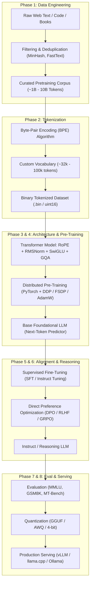

# Project Proton: Building Your Own LLM From Scratch
## Complete Master Architecture, Engineering Plan & Lab-Grade Methodology

> **Model Name:** **Proton** (Variants: *Proton-Micro*, *Proton-Mini*, *Proton-Instruct*)  
> **Target Audience:** Complete beginner with no prior LLM engineering experience, aiming to understand first principles and build a functional Large Language Model from scratch.  
> **Workspace:** `c:/Users/bommi/Downloads/Proton`  
> **GitHub Repository:** [AkashBommidi27/Proton-LM](https://github.com/AkashBommidi27/Proton-LM)  
> **Author & Mentorship:** Akash Bommidi & Antigravity AI

---

## Table of Contents
1. [Executive Summary & Philosophy](#1-executive-summary--philosophy)
2. [The Complete LLM Lifecycle (End-to-End Diagram)](#2-the-complete-llm-lifecycle-end-to-end-diagram)
3. [Phase-by-Phase Comprehensive Roadmap](#3-phase-by-phase-comprehensive-roadmap)
   - [Phase 0: Mathematical & Engineering Foundations](#phase-0-mathematical--engineering-foundations)
   - [Phase 1: Data Engineering & Pipeline Building](#phase-1-data-engineering--pipeline-building)
   - [Phase 2: Tokenization From Scratch](#phase-2-tokenization-from-scratch)
   - [Phase 3: Transformer Architecture from First Principles](#phase-3-transformer-architecture-from-first-principles)
   - [Phase 4: Pre-Training Infrastructure & Scaled Training](#phase-4-pre-training-infrastructure--scaled-training)
   - [Phase 5: Post-Training (SFT & Instruction Tuning)](#phase-5-post-training-sft--instruction-tuning)
   - [Phase 6: Alignment & Reasoning (DPO, RLHF, GRPO)](#phase-6-alignment--reasoning-dpo-rlhf-grpo)
   - [Phase 7: Evaluation & Benchmarking](#phase-7-evaluation--benchmarking)
   - [Phase 8: Quantization, Optimization & Production Inference](#phase-8-quantization-optimization--production-inference)
4. [Hardware & Software Matrix](#4-hardware--software-matrix)
5. [Budget & Cost Breakdown by Scale](#5-budget--cost-breakdown-by-scale)
6. [Parameter Sizing & Compute Scaling Rules](#6-parameter-sizing--compute-scaling-rules)
7. [What Leading AI Labs Do (Meta, DeepSeek, OpenAI, Anthropic, Mistral)](#7-what-leading-ai-labs-do)
8. [What Comes Next? (Advanced Horizons)](#8-what-comes-next-advanced-horizons)

---

## 1. Executive Summary & Philosophy

Building an LLM is not magic; it is **numerical optimization over discrete text tokens at scale**. 

A common misconception is that you need $100M and 10,000 H100 GPUs to build an LLM. While frontier models (GPT-4, Claude 3.5, Llama 3 405B) require tens of millions of dollars, **the exact same principles and modern architectures can be built, trained, and fine-tuned on consumer hardware and rented cloud GPUs for between $0 and $50**.

### The 3 Rules of This Journey
1. **Never use high-level black boxes first**: We will not start with `AutoModelForCausalLM.from_pretrained()`. We will first write the attention matrix, positional encodings, loss function, and tokenizer by hand in pure PyTorch/Python.
2. **Scale progressively**:
   - Level 1: **Micro-LLM (~5M-15M params)** trained on Shakespeare/Stories on your local laptop / CPU / Google Colab (takes 10-30 minutes, cost: $0).
   - Level 2: **Mini-LLM (~50M-125M params)** trained on cleaned web text / Python code using a single rented GPU like RTX 4090 or A10G (takes 4-8 hours, cost: ~$3 - $10).
   - Level 3: **Production SLM (~500M-1.5B params)** trained with modern lab tricks (RoPE, SwiGLU, RMSNorm, FlashAttention-2, Grouped-Query Attention) on cloud clusters (takes 1-3 days, cost: ~$30 - $100).
3. **Understand every byte**: We will master data tokenization, VRAM memory footprints, compute bandwidth, and training stability.

---

## 2. The Complete LLM Lifecycle (End-to-End Diagram)

---

## 3. Phase-by-Phase Comprehensive Roadmap

### Phase 0: Mathematical & Engineering Foundations
- **Duration:** 1 - 2 weeks
- **Objective:** Demystify the mathematical mechanics and prepare the developer environment.
- **Key Concepts:**
  - **Linear Algebra:** Matrix multiplication ($Q \times K^T$), vector projections, dimension shapes, dot products.
  - **Calculus:** Gradient descent, backpropagation, chain rule, partial derivatives.
  - **Probability & Statistics:** Softmax distribution, cross-entropy loss, temperature sampling, top-p/top-k.
  - **PyTorch Core:** Tensors, operations, `autograd`, broadcasting, custom `nn.Module`, GPU memory allocation (`torch.cuda`).
- **Hands-On Deliverable:**
  - Build a simple Multi-Layer Perceptron (MLP) from scratch predicting the next character in names/words.

---

### Phase 1: Data Engineering & Pipeline Building
- **Duration:** 1 - 2 weeks
- **Objective:** Collect, filter, deduplicate, and prepare text data at scale.
- **Key Concepts:**
  - *Data quality beats data quantity* (Llama 3, Phi-3, and DeepSeek findings).
  - Web scraping & Public Datasets (Common Crawl, FineWeb-Edu, RedPajama, SlimPajama, The Pile, GitHub code).
  - **Heuristic Filtering:** Length filters, stop-word ratios, symbol-to-word ratios, language identification (FastText).
  - **Deduplication:** MinHash LSH (Locality Sensitive Hashing) to eliminate duplicated web pages.
  - **Synthetic Data Generation:** Using frontier LLMs to filter, explain, and create dense educational data (Textbooks Are All You Need).
- **Hands-On Deliverable:**
  - Build a Python pipeline that downloads 1GB - 5GB of raw text, cleans it, deduplicates it, and outputs formatted documents.

---

### Phase 2: Tokenization From Scratch
- **Duration:** 3 - 5 days
- **Objective:** Convert human language into sequences of integers that computers can process.
- **Key Concepts:**
  - Why characters fail (sequences are too long, high memory cost).
  - Why words fail (infinite vocabulary, cannot handle out-of-vocabulary words or typos).
  - **Subword Tokenization:** Byte-Pair Encoding (BPE), WordPiece, Unigram.
  - Byte-level BPE (GPT-2, GPT-4, Llama): Treating raw bytes ($0-255$) as base tokens so *any* text in any language can be represented without `<UNK>` tokens.
  - Token compression ratio: How many characters per token on average (~3.5-4.5 characters/token).
- **Hands-On Deliverable:**
  - Implement a Byte-Pair Encoding (BPE) tokenizer from scratch in pure Python (similar to Andrej Karpathy’s `minbpe` or OpenAI’s `tiktoken`).
  - Train vocabulary sizes ($V = 4,096$ for toy models, $V = 32,000$ to $64,000$ for real models).

---

### Phase 3: Transformer Architecture from First Principles
- **Duration:** 2 - 3 weeks
- **Objective:** Build every single layer and block of a modern state-of-the-art decoder-only Transformer.
- **Detailed Component Breakdown:**
  1. **Input Embeddings & Weight Tying:** Token ID $\to$ Vector dimension $d_{model}$.
  2. **Rotary Position Embeddings (RoPE):** Replacing outdated absolute sinusoidal embeddings (Vaswani 2017) with complex rotary embeddings (Su et al., Llama/DeepSeek standard).
  3. **Self-Attention Mechanics:**
     - Query, Key, Value linear projections.
     - Scaled Dot-Product Attention: $\text{Attention}(Q, K, V) = \text{softmax}\left(\frac{QK^T}{\sqrt{d_k}} + M\right)V$.
     - Causal Masking (autoregressive upper triangular mask).
  4. **Multi-Head Attention (MHA) vs. Multi-Query Attention (MQA) vs. Grouped-Query Attention (GQA):**
     - Modern standard is GQA (e.g., 32 Query heads, 8 Key/Value heads) to drastically cut KV-cache memory during inference.
  5. **Normalization:** RMSNorm (Root Mean Square Normalization) instead of LayerNorm (faster, computationally cheaper, zero-mean property).
  6. **Feed-Forward Network (FFN):** SwiGLU (Swish Gated Linear Unit) activation instead of legacy ReLU/GELU.
  7. **Residual Connections:** Pre-LayerNorm (Pre-RMSNorm) stability architecture.
  8. **KV-Cache:** Efficient autoregressive decoding that caches previous key/value states so generation is $O(N)$ instead of $O(N^2)$.
- **Hands-On Deliverable:**
  - A clean, modular `model.py` file written in pure PyTorch (under 350 lines of code) implementing a complete Llama-3 style architecture.

---

### Phase 4: Pre-Training Infrastructure & Scaled Training
- **Duration:** 2 - 3 weeks
- **Objective:** Train the base model to predict the next token efficiently without crashes or exploding gradients.
- **Key Concepts:**
  - **Precision & Data Formats:** FP32 (float32) vs. FP16 vs. BF16 (bfloat16 - essential for stability, wide dynamic range) vs. FP8.
  - **Memory Anatomy of a GPU:**
     - Model weights: 2 bytes per param (in FP16/BF16).
     - Optimizer states (AdamW): 8-12 bytes per param.
     - Gradients: 2 bytes per param.
     - Activations: scales with context length and batch size.
  - **Optimizers:** AdamW ($\beta_1=0.9, \beta_2=0.95$, weight decay $0.1$) and cutting-edge optimizers like Muon.
  - **Learning Rate Schedules:** Cosine decay with linear warmup (warmup over first 2,000 steps, decay to 10% min LR).
  - **Gradient Accumulation & Gradient Clipping:** Simulating large batch sizes (e.g., 500k to 2M tokens per batch) across limited hardware.
  - **FlashAttention-2 / PyTorch SDPA:** Memory-efficient attention using GPU SRAM tiling to bypass slow HBM bandwidth.
  - **Distributed Scaling:**
     - DDP (Distributed Data Parallel): Single node, multiple GPUs.
     - FSDP (Fully Sharded Data Parallel) & DeepSpeed ZeRO 1/2/3: Sharding optimizer, gradients, and model weights across GPUs.
- **Hands-On Deliverables:**
  - Step 4.1: Train a **15M parameter model** on TinyStories / Shakespeare locally or on Google Colab T4 (Free).
  - Step 4.2: Train a **100M parameter model** on 1 Billion tokens on a rented RTX 4090 / A100 (~$5-$15).

---

### Phase 5: Post-Training (SFT & Instruction Tuning)
- **Duration:** 1 - 2 weeks
- **Objective:** Turn a raw "next-token completion engine" into a conversational, helpful assistant that follows instructions.
- **Key Concepts:**
  - **Why Base Models Fail at Conversation:** A base model completes questions with more questions. SFT teaches the model the "assistant" conversational pattern.
  - **Chat Templates:** System prompts, User turns, Assistant turns with special delimiting tokens (e.g., `<|im_start|>user\n...<|im_end|><|im_start|>assistant\n...<|im_end|>`).
  - **Instruction Datasets:** Alpaca, UltraChat, OpenHermes, ShareGPT, Dolly.
  - **Loss Masking:** Only computing loss on the assistant’s response, not the user's prompt.
  - **LoRA (Low-Rank Adaptation) & QLoRA:** Parameter-Efficient Fine-Tuning (PEFT) freezing the base weights and training tiny rank-decomposition matrices ($A$ and $B$).
- **Hands-On Deliverables:**
  - Format a high-quality multi-turn instruction dataset.
  - Fine-tune your pre-trained model (or a small open-source base model like Llama-3.2-1B / SmolLM) using LoRA and full-parameter SFT.

---

### Phase 6: Alignment & Reasoning (DPO, RLHF, GRPO)
- **Duration:** 1 - 2 weeks
- **Objective:** Align the assistant with human preferences and inject multi-step reasoning capabilities.
- **Key Concepts:**
  - **RLHF (Reinforcement Learning from Human Feedback):** Training a separate Reward Model, then using PPO (Proximal Policy Optimization). Computationally complex.
  - **DPO (Direct Preference Optimization):** The modern standard. Mathematical formulation that directly optimizes the policy model on paired chosen vs. rejected responses without needing a separate reward model.
  - **Reasoning Models (The DeepSeek-R1 / OpenAI o1 Paradigm):**
     - Test-time compute scaling: Giving the model tokens to "think" before answering.
     - **GRPO (Group Relative Policy Optimization):** Eliminates the critic model in PPO, evaluates groups of responses against verifiable rule-based rewards (e.g., math answer matching, code test case passing).
- **Hands-On Deliverables:**
  - Implement a DPO loss training step on chosen vs. rejected pairs.
  - Run a rule-based reward loop (GRPO-style) for mathematical verification.

---

### Phase 7: Evaluation & Benchmarking
- **Duration:** 1 week
- **Objective:** Rigorously verify that the model actually learned language, reasoning, and factual knowledge.
- **Key Benchmarks & Tools:**
  - **Perplexity (PPL):** Measures how surprised the model is by held-out test text (lower is better).
  - **Academic Benchmarks:**
     - MMLU (Massive Multitask Language Understanding) - General knowledge.
     - GSM8K (Grade School Math 8K) - Multi-step math reasoning.
     - HumanEval / MBPP - Code generation accuracy.
     - ARC / HellaSwag - Commonsense reasoning.
  - **Evaluation Harnesses:** `lm-evaluation-harness` (EleutherAI), Lighteval (Hugging Face).
  - **LLM-as-a-Judge:** Using GPT-4o / Claude 3.5 Sonnet to judge answers on MT-Bench.
- **Hands-On Deliverable:**
  - Automated evaluation script reporting zero-shot accuracy and perplexity across standard datasets.

---

### Phase 8: Quantization, Optimization & Production Inference
- **Duration:** 1 week
- **Objective:** Shrink the model weights and serve it with millisecond latency on laptops, phones, or web servers.
- **Key Concepts:**
  - **Quantization Types:**
     - **Post-Training Quantization (PTQ):** GGUF (k-quants), AWQ (Activation-aware Weight Quantization), GPTQ, EXL2.
     - 16-bit float (2 bytes/param) $\to$ 8-bit int (1 byte/param) $\to$ 4-bit (0.5 bytes/param).
     - Running a 7B model in 4GB of RAM instead of 14GB VRAM!
  - **Inference Engines:**
     - **llama.cpp**: Pure C/C++ engine running natively on Apple Silicon, CPU, or GPU with zero dependencies.
     - **vLLM**: PagedAttention engine for high-throughput multi-user batched server deployment.
     - **Ollama**: Packaging models into runnable Docker-like formats for easy local use.
- **Hands-On Deliverable:**
  - Export your trained model weights to Safetensors $\to$ Convert to GGUF format $\to$ Run via `llama.cpp` or Ollama locally on your machine.

---

## 4. Hardware & Software Matrix

| Stage | Hardware Required | Recommended Provider | Software Stack |
|---|---|---|---|
| **Phase 0 & 2** (Foundations & Tokenizer) | Any Laptop / Desktop (CPU is fine) | Local Machine (Windows / Mac / Linux) | Python 3.10+, PyTorch, NumPy |
| **Phase 1** (Data Cleaning) | Local CPU (Multi-core, 16GB RAM, 100GB Disk) | Local or Cheap VPS | Polars, DuckDB, `datasets`, MinHash |
| **Phase 3 & 4 (Toy Pretraining: 10M-50M)** | 1x Consumer GPU (RTX 3060, 4060, or Free Colab T4) | Local PC or Google Colab (Free) | PyTorch, `torch.compile`, Matplotlib |
| **Phase 4 (Serious Pretraining: 100M-500M)** | 1x RTX 4090 (24GB) or 1x A100 (40GB/80GB) | RunPod, Lambda Labs, Vast.ai ($0.40 - $1.80/hr) | PyTorch, FlashAttention-2, WandB, DDP |
| **Phase 5 & 6 (SFT & DPO)** | 1x RTX 4090 or A10G (24GB) | RunPod, Colab Pro | Hugging Face TRL, PEFT, Unsloth |
| **Phase 7 & 8 (Eval & Inference)** | Local PC (CPU or GPU) | Local Machine | `llama.cpp`, vLLM, Ollama |

---

## 5. Budget & Cost Breakdown by Scale

| Tier | Model Size | Training Tokens | Target Compute | Est. Time | Total Cost | Purpose |
|---|---|---|---|---|---|---|
| **Tier 1: Educational Micro** | 10M - 25M | 50M - 200M | Free Google Colab T4 or Local RTX 3060 | 1 - 3 hours | **$0.00** | Master code, verify attention, verify loss convergence |
| **Tier 2: Solid Hobbyist SLM** | 80M - 150M | 1B - 3B | 1x Rented RTX 4090 (24GB VRAM) | 12 - 24 hours | **$5 - $15** | Real coherent English/Python, follows simple grammar |
| **Tier 3: Serious Small LLM** | 500M - 1B | 10B - 20B | 2x or 4x RTX 4090 or 1x H100 SXM | 2 - 3 days | **$40 - $90** | Capable SLM (comparable to early GPT-2 / SmolLM) |
| **Tier 4: Research Frontier** | 3B - 8B | 1 Trillion+ | Cluster of 8x to 64x H100 | Weeks | **$10,000+** | Leading enterprise / academic research scale |

> **Recommendation for you:** We will start with **Tier 1 ($0)** to master every equation and write the code from scratch. Once your code is bulletproof, you can optionally run a **Tier 2 ($5-$15)** pre-training run on RunPod to create your own genuine foundation model!

---

## 6. Parameter Sizing & Compute Scaling Rules

### Chinchilla Scaling Law (Hoffmann et al., DeepMind)
For compute-optimal training:
$$\text{Tokens} \approx 20 \times \text{Parameters}$$
- A **100M parameter model** needs at least **2 Billion tokens** to be compute-optimal.
- Modern labs (Llama 3) intentionally **overtrain** (e.g., Llama 3 8B trained on 15 Trillion tokens = ~1,875 tokens per parameter) because smaller overtrained models are drastically cheaper to run at inference time!

### Memory Rule of Thumb (Training VRAM in Bytes)
$$\text{VRAM}_{\text{training}} \approx 16 \times \text{Parameters} + \text{Activations}$$
- For a **1 Billion parameter model**:
  - Model weights (BF16): 2 GB
  - Gradients: 2 GB
  - Optimizer states (AdamW): 8 GB
  - **Total minimal baseline VRAM:** ~12-16 GB (fits on a single RTX 4090 or A10G!).

---

## 7. What Leading AI Labs Do

| Component | Classical Transformer (Vaswani 2017 / GPT-2) | Cutting-Edge Lab Standard (Llama 3, DeepSeek V3, Mistral) | Why Labs Shifted |
|---|---|---|---|
| **Positional Encoding** | Absolute Sinusoidal / Learned Absolute | **RoPE (Rotary Position Embeddings)** with YaRN scaling | Extrapolates to 128k+ token context lengths smoothly |
| **Normalization** | Post-LayerNorm or Pre-LayerNorm | **RMSNorm (Root Mean Square Normalization)** | 10-50% faster, removes redundant mean computation |
| **Activation Function** | ReLU / GELU | **SwiGLU (Swish Gated Linear Unit)** | Superior gradient flow, consistently lower perplexity |
| **Attention Mechanism** | Multi-Head Attention (MHA) | **Grouped-Query Attention (GQA)** & **Multi-head Latent Attention (MLA)** | 4x to 8x smaller KV-cache memory during generation |
| **Data Filtering** | Basic web scrape | **Synthetic data + Web deduplication + Heuristic quality classifiers** | High signal-to-noise ratio; prevents model hallucination |
| **Optimizer** | Standard AdamW | **AdamW with Cosine decay / Muon / Schedule-Free** | Faster convergence, immune to loss spikes |
| **Post-Training** | Supervised Finetuning only | **SFT $\to$ DPO / GRPO (Test-time reasoning scaling)** | Teaches deliberate self-correction and reasoning chains |

---

## 8. What Comes Next? (Advanced Horizons)

Once your core foundation LLM is running, the frontier opens up:
1. **Mixture of Experts (MoE):** Splitting the feed-forward layers into 8-64 sparse experts (like Mixtral 8x7B or DeepSeek-V3), activating only 2 per token for 10x faster inference.
2. **Reasoning & Self-Correction:** Training models to produce `<think> ... </think>` chains using rule-based reinforcement learning (like DeepSeek-R1 / OpenAI o1).
3. **Multimodal Expansion:** Adding a vision encoder (like SigLIP) with a projection projector to process images alongside text.
4. **Tool Use & Autonomous Agents:** Teaching the model function calling using structured JSON outputs to interact with APIs and code execution sandboxes.
